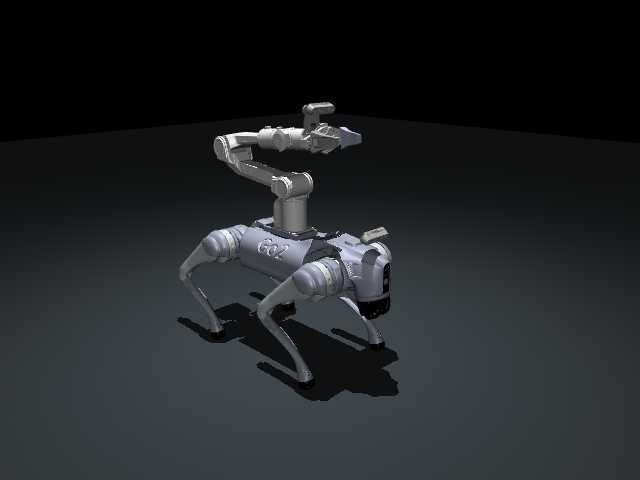

# Go2 + Piper + 双 D435 独立模型资产

本目录可以整体复制、压缩或作为独立 ROS 2 描述包分享。无需原训练仓库、策略权重或原作者电脑上的模型目录。
当前模型为 `go2-piper-d435-cad-nominal-gripper-direction-v4`，包含 Go2、Piper、夹爪、腕部支架，以及头部和腕部两台 D435。



| 用途 | 入口 |
| --- | --- |
| Isaac Sim | `isaac_sim/go2_piper_d435.usd` |
| Isaac Lab 配置参考 | `isaac_sim/model_cfg.py` |
| MuJoCo 机器人 | `mujoco/go2_piper_d435.xml` |
| MuJoCo 带地面场景 | `mujoco/scene.xml` |
| Gazebo Sim 机器人 | `gazebo/model.sdf`，由根目录 `model.config` 索引 |
| Gazebo Sim 静态预览场景 | `gazebo/preview.sdf` |
| URDF 文件导入 | `urdf/go2_piper_d435.urdf`，网格使用相对路径 |
| ROS 2 / RViz | `urdf/go2_piper_d435.ros.urdf`，网格使用 `package://` |
| 关节信息 | `joint_metadata.json` |
| 来源和文件校验 | `asset_manifest.json`、`SHA256SUMS`、`licenses/` |

## Isaac Sim / Isaac Lab

在 Isaac Sim 中用 **File → Open** 打开 USD，或将其作为 reference 加入已有场景。几何、颜色、碰撞、质量和关节已经封装在单个 USD 中，其他目录不是该 USD 的运行依赖。米制、Z 轴向上，默认 prim 为 `/go2_piper_d435`，浮动关节树根在 `base`。

USD 从当前仓库逐字节复制。它提供 D435 外观和 `base/HeadCameraOpticalFrame`、`link6/WristCameraOpticalFrame` 两个 ROS 光学坐标锚点；要生成图像，需要在场景中另外创建 Camera / RGB-D 传感器。光学坐标约定为 X 向右、Y 向下、Z 向前。相机外壳中心与光学中心不同，请分别使用 `camera_mounts` 和光学锚点。

`isaac_sim/model_cfg.py` 是当前 Isaac Lab 配置的便携副本，USD 路径已改为同目录。需要 Isaac Lab 环境才能导入该 Python 文件。USD 本身没有站立或抓取控制器；动态仿真需要地面、PhysicsScene 和关节控制。可使用配置中的基座高度 0.42 m、腿部姿态和 PD 参数作为项目仿真参考。

## MuJoCo

在独立 Python 环境安装 `mujoco`，从本目录执行：

```bash
python -m mujoco.viewer --mjcf=mujoco/scene.xml
```

或者从任意工作目录使用绝对文件路径：

```python
from pathlib import Path
import mujoco

bundle = Path("/your/path/go2_piper_d435_assets")
model = mujoco.MjModel.from_xml_path(str(bundle / "mujoco/scene.xml"))
data = mujoco.MjData(model)
mujoco.mj_resetDataKeyframe(model, data, 0)  # 源 home 姿态
mujoco.mj_forward(model, data)
```

模型有 27 个 qpos（浮动基座 7 + 20 个活动关节）、19 个力矩/力执行器，以及头部 `head_camera` 和腕部 `piper_wrist_camera`。夹爪由单个执行器和 equality 耦合。home 只设置初始位姿，不会提供站立控制。

便携 MJCF 以当前 v4 XML 为源，改为包内相对网格路径，并补齐 USD 已有的官方 D435 外观、头部相机/碰撞、腕部支架碰撞和 link1 碰撞。原关节轴、指垫、刚体坐标及惯量保留。源 OBJ 中指向缺失 MTL 的引用已移除，使用模型内定义的颜色；没有外置纹理依赖。

## Gazebo Sim

提供 SDFormat 1.9 模型和面向 Gazebo Sim Harmonic 的预览 world。模型中的网格使用 `model://go2_piper_d435_assets/...`，因此请保留目录名称，并把它的**上一级目录**加入资源路径。从本目录执行：

```bash
export GZ_SIM_RESOURCE_PATH="$(dirname "$PWD")${GZ_SIM_RESOURCE_PATH:+:$GZ_SIM_RESOURCE_PATH}"
gz sim gazebo/preview.sdf
```

预览场景将机器人设为静态，方便查看完整装配；按 Play 可启动 world 内两台示例 RGB-D 传感器。动态接入时，将 `model://go2_piper_d435_assets` include 到自己的 world，设置 `<static>false</static>`，配置初始关节姿态并接入自己的控制器。模型本体保持浮动基座，包含全部 20 个活动关节。

SDF 1.9 中未配置夹爪 mimic 插件，动态控制时必须同时发送 `joint7=opening/2` 和 `joint8=-opening/2`。URDF 的 mimic 标签也需要目标控制栈支持。没有打包 `ros2_control`、Gazebo Classic ROS 相机插件或站立策略。

Gazebo 的示例 RGB-D 相机使用包内光学安装位姿及 MJCF 视场角，方形 640×640、10 Hz；这是通用渲染传感器，不是 D435 双目、结构光、噪声或工厂内参的完整仿真。传感器朝向已从光学坐标转换成 Gazebo 的 X 向前约定。配置依据 [SDFormat 坐标语义](https://sdformat.org/tutorials/specification/pose_frame_semantics/1.7/) 和 [Gazebo 传感器文档](https://gazebosim.org/docs/harmonic/sensors/)。

## URDF / ROS 2

文件导入可直接选择 `urdf/go2_piper_d435.urdf`，并保持目录结构。ROS 2 / RViz 使用 `package://` 版本：把整个目录放入工作空间 `src/`，在工作空间根目录执行：

```bash
colcon build --packages-select go2_piper_d435_assets
source install/setup.bash
```

之后将安装目录中的 `urdf/go2_piper_d435.ros.urdf` 作为 `robot_state_publisher` 的 `robot_description`。此包只安装描述文件和网格，不启动任何控制节点。

URDF/SDF 从便携 MJCF 的编译结果导出：保留浮动基座、12 个腿关节、6 个臂关节、2 个夹爪关节和质量/主惯量。capsule 转为 cylinder 加两端 sphere；碰撞网格导出为凸包。它们没有使用上游固定腿的硬件 URDF。

## 关节、动力学和版本差异

- 夹爪总开口：`opening_m = joint7 - joint8`。项目常用 0–0.076 m；模型关节硬限位允许总开口 0–0.10 m。两指开口增大时向外分离。
- MJCF 和 URDF/SDF 保留源执行器力矩上限：臂前三轴 32 Nm、后三轴 8 Nm，夹爪 10 N；Isaac Lab 配置中臂的仿真力矩上限为 20 Nm。请按自己的控制栈统一这些设置；格式转换不保证动力学逐步一致。
- URDF/SDF 的关节速度字段采用项目仿真配置：腿 30 rad/s、臂 5 rad/s、单指 1 m/s，不作为硬件额定参数。
- 原模型已有的复合惯量保留，没有重复加入相机和支架质量。头部 D435 没有新增支架。相机安装是 CAD 名义位姿，未作为实测手眼标定；碰撞盒也不是完整硬件包络。

## 校验和重新导出

从本目录运行：

```bash
python validate.py                 # 标准库：文件哈希、资源闭包、模型拓扑
python validate.py --physics       # 需要 numpy scipy mujoco；检查多姿态 FK、惯量、编译及短步进
python validate.py --usd           # 需要可导入 pxr 的 OpenUSD / Isaac Python 环境
```

实际导出环境和已完成的检查记录在 `VALIDATION.md`。Gazebo GUI 的运行验证状态也在该文件中说明。

在原仓库中重新导出：

```bash
python scripts/tools/export_go2_piper_d435_assets.py --zip
```

重新导出需要 `numpy scipy mujoco trimesh` 和 `--source` 指向的上游网格源。接收分享包的人只需本目录，不需要这些上游文件。分享 ZIP 时，请同时保留 `licenses/` 中的原许可证和来源说明。
