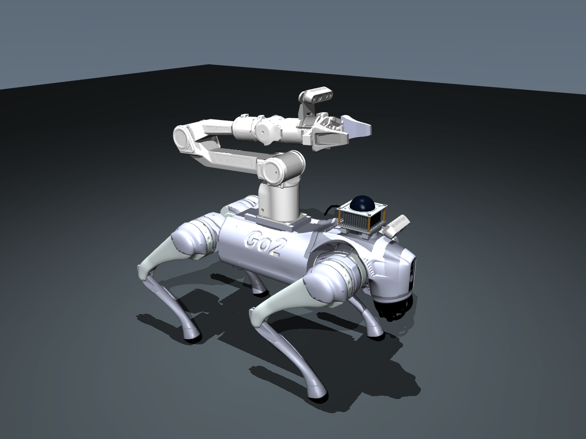
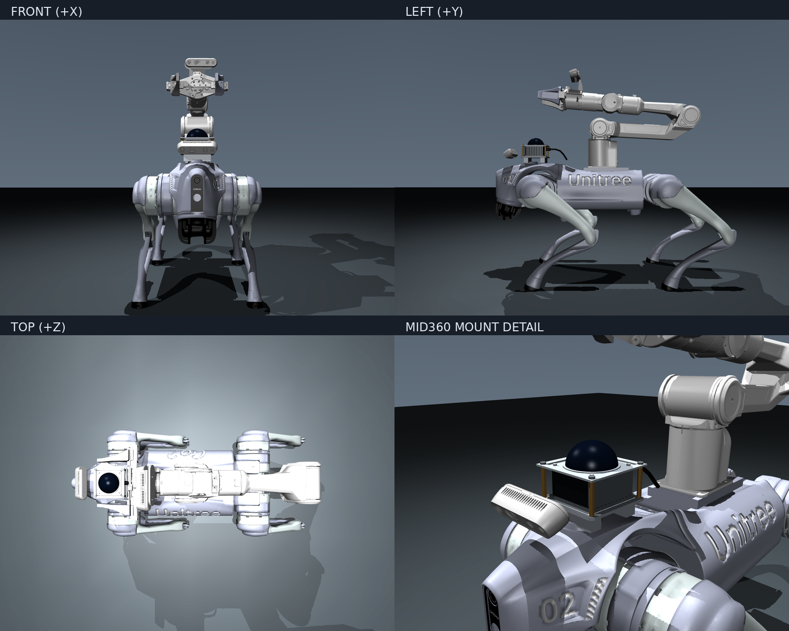

# Go2 + Piper + 双 D435 + MID360 资产模型

基于原始 `go2_piper_d435_assets` 新增 MID360 雷达和固定支架。此目录可整体复制使用，运行不依赖原资产目录；原始目录未修改。

位置参考用户提供的俯视、前视、左视照片：雷达安装在 Go2 前肩附近的机背中央、头部 D435 后侧，圆顶竖直向上。外观包括深蓝色圆顶、散热片、接头及短线缆、铝色框架、铜色立柱和螺钉，按照片近似建模。





## 模型入口

| 用途 | 文件 |
| --- | --- |
| ROS 2 / RViz | `urdf/go2_piper_d435_mid360.ros.urdf`（新包的 package URI） |
| 通用 URDF 导入 | `urdf/go2_piper_d435_mid360.urdf`（包内相对路径） |
| MuJoCo 机器人 | `mujoco/go2_piper_d435_mid360.xml` |
| MuJoCo 带地面场景 | `mujoco/scene.xml` |
| Gazebo Sim | `gazebo/model.sdf`、`model.config` |
| Gazebo 静态预览 | `gazebo/preview.sdf` |
| Isaac Sim / OpenUSD | `isaac_sim/go2_piper_d435_mid360.usd` |
| Isaac Lab 配置参考 | `isaac_sim/model_cfg.py`，配置变量 `GO2_PIPER_CFG` |
| 新增网格 | `meshes/mid360/` 内 9 个 STL |
| 安装参数 | `mid360_mount.json` |
| 单独预览 | `previews/front.png`、`left.png`、`top.png`、`mid360_detail.png` |

USD 默认 prim 为 `/go2_piper_d435_mid360`，内部封装全部几何，不依赖包外资源。

## 安装坐标

统一使用米制；机器人 `base` 坐标为 X 朝前、Y 朝左、Z 朝上。

| 部件 | 父坐标系 | xyz（m） | rpy（rad） |
| --- | --- | --- | --- |
| `mid360_mount` 支架 | `base` | `0.205 0 0.085` | `0 0 0` |
| `mid360_link` 雷达 | `mid360_mount` | `0 0 0.020` | `0 0 0` |
| `mid360_link` 合成位置 | `base` | `0.205 0 0.105` | `0 0 0` |

`mid360_link` 原点位于雷达本体底面中心，顶点约为 `base` 上方 0.165 m。这是本资产的机械装配约定，没有推测厂商光学中心、IMU 外参或实测标定。

雷达本体按 Livox 官方 **65 × 65 × 60 mm、265 g** 规格构建，接头、支架及线缆在本体尺寸之外。来源：[Livox MID-360 官方参数](https://www.livoxtech.com/mid-360/specs)。支架质量估计为 75 g，新增总质量 340 g；整机模型总质量约 19.185414 kg。新增部件的质心和惯量为几何估计。

装配关系为 `base → mid360_mount → mid360_link`，两处均固定连接。保留原有部件的几何、质量、惯量、关节限位、夹爪耦合及控制参数。整机有 27 个带质量的刚体、20 个活动关节、19 个 MuJoCo 执行器及两台 D435；MuJoCo 为 `nq=27`、`nv=26`。

本次增加雷达几何、碰撞与质量描述，不包含 Livox 驱动、点云生成器或 MID360 非重复扫描模拟。D435 外观、光学锚点和已有相机设置保留；站立、机械臂与夹爪控制需由使用项目接入。

## 使用

在本目录运行 MuJoCo：

```bash
python -m mujoco.viewer --mjcf=mujoco/scene.xml
```

ROS 2：把本目录放入工作空间 `src/`，在工作空间根目录构建：

```bash
colcon build --packages-select go2_piper_d435_mid360_asset
source install/setup.bash
```

在 RViz 中加载 `.ros.urdf`，Fixed Frame 设为 `base`。此包只安装模型描述，不启动控制节点。包名与原资产不同，关节名和大部分 TF 帧名保留；多个实例同场使用时自行设置命名空间。

Isaac Sim：通过 File → Open 打开上述 USD。Isaac Lab 参考配置的 USD 路径已更新，控制参数沿用基础资产。

Gazebo：从本目录执行：

```bash
export GZ_SIM_RESOURCE_PATH="$(dirname "$PWD")${GZ_SIM_RESOURCE_PATH:+:$GZ_SIM_RESOURCE_PATH}"
gz sim gazebo/preview.sdf
```

预览将整机设为静态。动态使用需设置初始姿态并接入控制器；SDF 没有夹爪 mimic 插件，需同时控制 `joint7` 和 `joint8`。

## 校验和修改

```bash
python validate.py                    # 标准库：文件哈希、资源闭包与拓扑
python validate.py --physics          # 需要 numpy、scipy、mujoco
python validate.py --usd              # 需要可导入 pxr 的 OpenUSD 环境
python validate.py --physics --usd    # 完整格式检查
```

实际检查结果与范围见 `VALIDATION.md`。`tools/generate_mid360_meshes.py` 使用 NumPy/Trimesh 重建新增网格；`tools/render_preview.py` 使用 MuJoCo EGL 和 Pillow 重建预览。修改包内已记录文件后需更新清单和 SHA256SUMS。调整安装位姿时，应同步更新 MJCF、两份 URDF、SDF、USD 及 `mid360_mount.json`。

保留 `licenses/` 和来源记录。新增 MID360 为程序生成的简化几何，未引入第三方 MID360 CAD。
