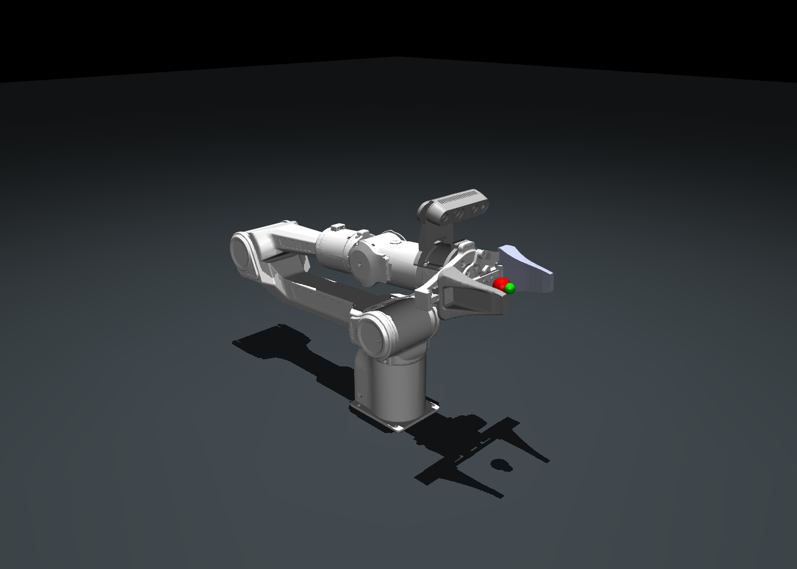

# Piper + 单 D435 独立模型资产

由同级 `go2_piper_d435_assets` 提取：保留 Piper 六轴机械臂、双指夹爪、腕部专用连接件和一台 D435。移除 Go2、四足关节与头部相机。所有运行资源均在本包内，源目录未修改。

| 用途 | 入口 |
| --- | --- |
| Isaac Sim | `isaac_sim/piper_d435.usd` |
| Isaac Lab 配置 | `isaac_sim/model_cfg.py` 中 `PIPER_D435_CFG` |
| MuJoCo 模型 / 场景 | `mujoco/piper_d435.xml` / `mujoco/scene.xml` |
| URDF 导入 / ROS 2 | `urdf/piper_d435.urdf` / `urdf/piper_d435.ros.urdf` |
| Gazebo Sim | `gazebo/model.sdf` / `gazebo/preview.sdf` |



## 装配与坐标

采用米制、Z 向上。Piper 底座 CAD 原点位于模型原点，底座固定。原模型的底座安装平移为 Z=0.07 m，本模型整体扣除该偏移，joint1 相对底座为 Z=0.123 m。保留 joint1–joint6 原限位、轴向和各活动刚体惯量；保留 joint7/joint8 双指。连接件与 D435 外观及碰撞保持在 link6 原安装位置，光学坐标为 `WristCameraOpticalFrame`，相机朝向与原模型相同。

腕部支架和相机与 link6 为同一刚体；原复合惯量保留，不重复增加质量。原 Piper 底座惯量已合并在 Go2 身体中，无法从本包可靠拆分，因此本资产只定义固定底座，不提供独立底座动力学参数。USD 底座为静态几何，joint1 一端连接世界；SDF 使用 world_fixed；URDF 的 base 作为固定安装根，导入动态仿真器时选择固定基座。

## 使用

MuJoCo：`python -m mujoco.viewer --mjcf=mujoco/scene.xml`。

MuJoCo 为 8 个关节位置、7 个力矩/力执行器和 1 台腕部相机。夹爪 equality 约束为 joint8=-joint7，URDF 带 mimic；Gazebo 和 Isaac Lab 控制时同时下发两指目标。总开口 opening=joint7-joint8，建议 0–0.076 m，模型硬限位允许 0–0.10 m。home 为臂关节全零、总开口 0.076 m。执行器保持力矩接口，home 不提供机械臂抗重力控制。

Isaac Sim 打开 `isaac_sim/piper_d435.usd`；默认 prim `/piper_d435`。USD 自包含，保留腕部光学坐标锚点，输出 RGB-D 图像需另建相机传感器。Isaac Lab 配置为参考，未在 Isaac Sim GUI 中运行验收。

Gazebo 从本文件夹执行：

```bash
export GZ_SIM_RESOURCE_PATH="$(dirname "$PWD")${GZ_SIM_RESOURCE_PATH:+:$GZ_SIM_RESOURCE_PATH}"
gz sim gazebo/preview.sdf
```

预览 world 整机静态，便于检查。动态场景引用 model.config 对应的模型，底座仍由 world_fixed 固定。仅有一台示例 RGB-D 传感器，不等同于 D435 完整硬件成像仿真。

ROS 2：将本文件夹置于工作空间 src 下，运行 `colcon build --packages-select piper_d435_assets` 后 source 工作空间，使用 package:// 版本的 URDF。

## 验证与来源

运行 `python validate.py` 检查哈希、模型拓扑和资源闭包；安装 MuJoCo、NumPy、SciPy 后运行 `python validate.py --physics` 检查多姿态运动学和短时步进。结果见 `VALIDATION.md`。`preview.png` 为新模型的实际 MuJoCo 渲染。

保留原许可证与来源记录于 licenses；其中旧包路径仅为历史来源说明。安装位姿为原 CAD 名义值，不代表实测手眼标定。
